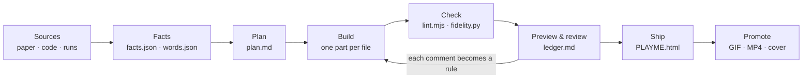

<p align="center">
  
</p>

<h3 align="center">Don't just README. PLAYME.</h3>

<p align="center">
  A Claude Code skill that turns your paper or project into <b>PLAYME.html</b>, one interactive page.<br>
  Readers operate your project's mechanisms instead of reading about them.
</p>

<p align="center">
  <a href="https://hzzhou01.github.io/PLAYME.html/"><b>▶ Live demo</b></a> ·
  <a href="#quick-start">Quick start</a> ·
  <a href="skills/playme/SKILL.md">SKILL.md</a> ·
  <a href="#the-18-rules">The 18 rules</a> ·
  <a href="README.zh-CN.md">中文</a>
</p>

<p align="center">
  
  
  
  
</p>

<p align="center">
  
</p>

---

## Why

A README tells the reader what your project does. A figure shows one frozen frame of it. Neither lets the reader
**watch the mechanism work**, which is what makes a design convincing.

Interactive explanations have always been better at this, and they have always been expensive. When Distill paused
in 2021, its editors wrote that *"the primary bottleneck is the amount of effort it takes to produce these articles."*
A coding agent can now do that effort. PLAYME is the skill that tells it how to do it well: which interactions to
build for which claims, how much a reader can take in per section, and how to stay exactly faithful to the paper.

> PLAYME made a real research project interactive: the **OpenGCUA Interactive Lab**, seven labs and 18 playable parts
> that Claude Code built with PLAYME in one session while the paper's authors reviewed each preview. Each rule below
> links to the review comments it answers (28 comments over seven rounds).

## What changes

|  | A typical project page | A PLAYME |
|---|---|---|
| The reader | reads a claim | operates the mechanism and watches it happen |
| Figures | frozen frames | players with a progress bar you can scrub; key moments marked |
| Code | a listing | the code that runs, beside the scene, with the decisive token highlighted |
| Depth | everything at once | one minute on the main line; depth in closed folds |
| Numbers | typed by hand | one facts file, checked against the paper by a script |
| Comparisons | separate figures | same task, same clock, side by side |
| Delivery | a site and its assets | `PLAYME.html`: one file that opens offline |

## Quick start

**1. Install** (Claude Code)

```text
/plugin install playme --marketplace hzzhou01/PLAYME.html
```

On Claude Code versions before 2.1.275, add the marketplace first:

```text
/plugin marketplace add hzzhou01/PLAYME.html
/plugin install playme@playme
```

or copy the skill folder:

```bash
git clone https://github.com/hzzhou01/PLAYME.html
cp -r PLAYME.html/skills/playme ~/.claude/skills/
```

**2. Ask**

```text
Use the playme skill to turn ./paper (LaTeX), ./code and ./runs into a PLAYME for our project.
Our highlights are code execution and the cross-device SDK. English and Chinese.
```

Claude reads the paper, builds a facts file and a glossary, proposes a plan of parts for you to approve, builds the
parts with the kit, checks them, and gives you a preview. You review in rounds; each comment becomes a rule that is
applied to every part. At the end you get `PLAYME.html`.

## How it works



Every section of a PLAYME is a **part** built from one template:

```text
question      one plain question, at most 14 words
┌ stage ─────────────────────────────────────────────────────┐
│ ▶ Play   ━━━━━━━━●━━━━━━━━━━━━━━━━━━━  0:07 / 0:14          │  one primary action, a scrubbable progress bar
│ scene: the thing that moves (a Mac, a 3D stack, four lanes) │
│ narration: short captions while it runs                     │
└ source line: Simulation for illustration · Paper §4.1 ──────┘  plain text, never a button
outcome       1-3 big readouts
takeaway      one sentence
go deeper ▸   at most 4 closed folds: code, real runs, numbers, caveats
```

<p align="center"></p>

`lint.mjs` measures each part the way a first-time reader experiences it:

| Reader budget, per part at rest | Limit |
|---|---|
| Question | 14 words (30 Chinese characters) |
| Prose outside the stage | 70 words (140 characters) |
| Primary buttons | exactly 1 |
| Visible controls outside the scene | 4 |
| Folds | 4, all closed |
| Labels that look like buttons but are not | 0 |
| Part height at 1440 px | 1250 px |
| Horizontal overflow at 400 px, console errors | 0 |

## The 18 rules

PLAYME applied these rules in the OpenGCUA build; most answer a specific author comment. Round ids point into the
[review ledger](skills/playme/references/review-loop.md).

| | Rule | Review |
|---|---|---|
| R1 | Experience, not presentation: each part lets the reader operate one mechanism. | the brief |
| R2 | Design for the one-minute reader: one question, one button, one visible difference, one sentence. | R2.5 |
| R3 | Familiar first, then the highlight, then the depth. | R2.6, R7.2 |
| R4 | One primary action and at most two options. | R2.1 |
| R5 | Only interactive things look interactive. | R2.1 |
| R6 | Make the key event unmistakable: repeat it, mark it, flash it. | R2.3, R4.4 |
| R7 | Every player has a progress bar. | R4.2 |
| R8 | Show the code with the intent; highlight the decisive token; scroll both ways. | R4.3, R4.5, R6.2 |
| R9 | Comparisons fit one view. | R2.5 |
| R10 | Devices look like devices. | R4.6, R6.1 |
| R11 | Precise, plain words; titles name the claim. | R2.2, R7.2 |
| R12 | Fold the depth. | R2.4 |
| R13 | Never contradict the paper. | R2.7, R3, R7.4 |
| R14 | Scrub private data from real material. | real runs |
| R15 | Ship one offline file, bilingual if the audience is. | R5 |
| R16 | Look as good as it plays. | R2.8 |
| R17 | Preview early; turn each comment into a rule and apply it everywhere. | all rounds |
| R18 | The lab is the promo. | after launch |

## Nine patterns

Pick the interactive form from the claim, not from the widget. Details, scene sketches and kit code:
[`references/patterns.md`](skills/playme/references/patterns.md).

| The claim is about... | Pattern | Example question |
|---|---|---|
| hidden structure | Exploded view (3D) | What does an agent see of a Mac, and what lies underneath? |
| an assumption that breaks in reality | Two worlds | Same click, benchmark vs real Mac: where does it land? |
| several methods on one task | Race | Same task, four ways to act: how many steps each? |
| robustness to change | Perturbation | The screen changes after the agent looked. What now? |
| who decides what, when | Decision timeline | Does the model need a screenshot every step? |
| an architecture | Request trace | A program fails. Which layer catches it? |
| one interface, many targets | One program, many devices | Can one program drive a phone, a browser and a Mac? |
| what actually happened | Real-run replay | Same task, five models: how many steps did each take? |
| what the generated code does | Program anatomy | What does one program do that ten clicks cannot? |

## What is in the box

```text
skills/playme/
  SKILL.md                 workflow, rules, budgets (loaded by Claude)
  references/              patterns · review-loop · fidelity · words · visual · kit · ship-and-promote
  kit/                     plain JS + CSS, no build step
    playme.js / .css       part template, player on a virtual clock, code pane, folds, readouts
    playme-desk.js / .css  Mac desktop, windows, browser, phone, terminal, two pointers
    playme-3d.js / .css    exploded 3D view on three.js r160 (loaded on demand, works offline)
  scripts/
    bundle.py              one self-contained offline HTML file
    lint.mjs               reader budgets, overflow, console errors; text dump
    fidelity.py            quotes, Paper §/Fig./Table references, facts and banned words vs the paper
    capture.mjs            frame-exact GIF / MP4 from any player
  templates/               starter page, plan.md, ledger.md, facts.json, words.json
site/                      this project's own homepage, built with the kit
PLAYME.html                that homepage as one offline file: double-click it
examples/starter/          the starter, bundled (one part)
examples/second-chance/    a PLAYME built blind for a toy caching paper (three parts, no agents involved)
```

Players run on a **virtual clock**: every wait and every motion goes through the kit, so the same script plays in
real time, seeks instantly when the reader drags the progress bar, jumps to the end under reduced motion, and is
captured frame by frame for GIFs and videos.

## Case: OpenGCUA, made interactive with PLAYME

<p align="center"></p>

| 7 labs | 18 playable parts | 28 author requests in 7 rounds | 1 offline file, EN + 中文 |
|---|---|---|---|

With PLAYME, the first preview went out four hours after the brief. The
[review ledger](skills/playme/references/review-loop.md) records every request and the rule that answers it.

## FAQ

**Does it only work for papers?** No. Any project with a mechanism worth watching works: a library, a system, an
algorithm. The fidelity checks then run against your docs instead of a paper.

**Does it work on a project it has never seen?** We gave a fresh agent only `SKILL.md` and a small caching-policy
paper it had never seen. In about 20 minutes it planned and built a three-part PLAYME (an eviction ring you can step
through, the burst rule, the printed results), passed `lint.mjs`, opened the bundle offline, and flagged a number in
the paper's text that disagreed with its own table. Its notes on what was unclear went straight back into the skill. The result is in
[`examples/second-chance/`](examples/second-chance/).

**Do I need Claude Code?** The skill is written for Claude Code and uses only the portable `SKILL.md` fields, so it
also loads in other Agent Skills hosts. The kit and scripts are plain JS, Python and Node; you can use them by hand.

**Does the page need a server or the network?** No. `bundle.py --offline` inlines everything, three.js included.

**What if WebGL is unavailable?** The 3D view falls back to a CSS layer stack with the same content.

## Acknowledgements

Built on the ideas of explorable explanations ([Bret Victor, 2011](https://worrydream.com/ExplorableExplanations/))
and [Distill](https://distill.pub/). Uses [three.js](https://threejs.org/) (MIT). Homepage fonts: Archivo, Instrument
Sans and JetBrains Mono (SIL OFL 1.1).

## License

[MIT](LICENSE)
