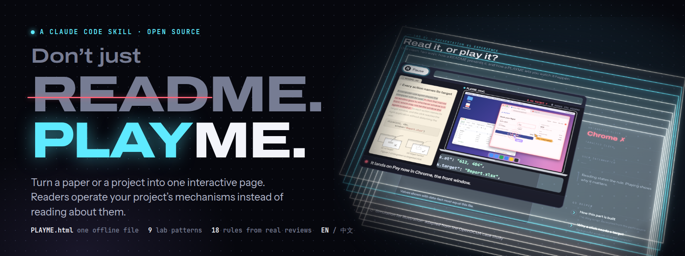
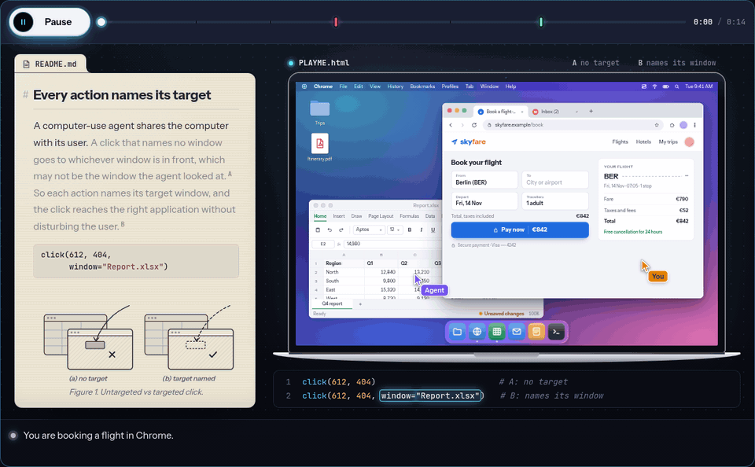
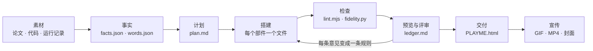
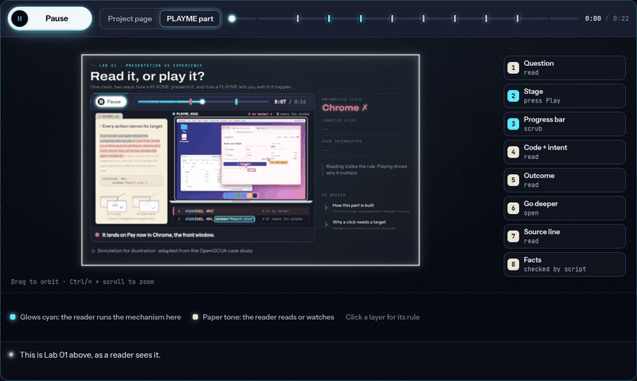
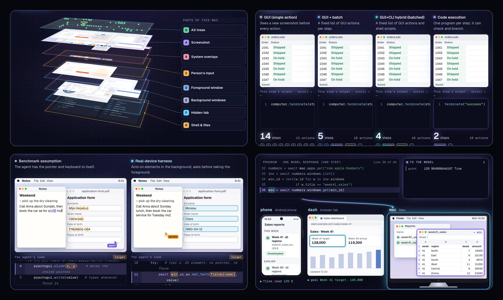

<p align="center">
  
</p>

<h3 align="center">Don't just README. PLAYME.</h3>

<p align="center">
  <b>别只写 README，给项目一个 PLAYME。</b><br>
  一个 Claude Code skill：把论文或项目变成 PLAYME.html，一个读者能亲手操作项目机制的交互页面。
</p>

<p align="center">
  <a href="https://hzzhou01.github.io/PLAYME.html/?lang=zh"><b>▶ 在线体验</b></a> ·
  <a href="#快速开始">快速开始</a> ·
  <a href="skills/playme/SKILL.md">SKILL.md</a> ·
  <a href="#18-条规则">18 条规则</a> ·
  <a href="README.md">English</a>
</p>

<p align="center">
  
  
  
  
</p>

<p align="center">
  
</p>

---

## 为什么做 PLAYME

README 告诉读者项目做了什么，论文插图展示的是某一帧静止的画面。两者都不能让读者**亲眼看到机制如何运转**，而这恰恰是一个设计最有说服力的地方。

交互式讲解一直更好，也一直很贵。Distill 在 2021 年宣布暂停时，编辑们写道：*“主要瓶颈在于制作这些文章所需的工作量。”* 如今这份工作量可以交给编程智能体。PLAYME 告诉它怎样做好：什么样的结论配什么样的交互、每个部分读者能接受多少信息、怎样与论文保持严格一致。

> PLAYME 让一个真实的研究项目变得可交互：**OpenGCUA 交互实验室**。7 个实验、18 个可播放部件，由 Claude Code 借助 PLAYME 在一次会话中完成，论文作者逐版评审了每次预览。下面每条规则都标明了它回应的评审意见（7 轮评审，共 28 条）。

## 有什么不同

|  | 常见的项目主页 | PLAYME |
|---|---|---|
| 读者 | 读一个结论 | 亲手操作机制，看着它发生 |
| 插图 | 静止的画面 | 带进度条的播放器，可拖动；关键时刻有标记 |
| 代码 | 一段代码清单 | 运行中的代码就在场景旁边，关键参数高亮 |
| 深度 | 一次性全部摊开 | 主线一分钟看懂；深入内容默认折叠 |
| 数字 | 手动录入 | 统一存放在一个事实文件里，由脚本与论文核对 |
| 对比 | 分开的几张图 | 同一任务、同一时钟、并排呈现 |
| 交付 | 一个网站和一堆资源 | `PLAYME.html`：一个离线就能打开的文件 |

## 快速开始

**1. 安装**（Claude Code）

```text
/plugin install playme --marketplace hzzhou01/PLAYME.html
```

Claude Code 2.1.275 之前的版本需要先添加插件市场：

```text
/plugin marketplace add hzzhou01/PLAYME.html
/plugin install playme@playme
```

或直接复制 skill 目录：

```bash
git clone https://github.com/hzzhou01/PLAYME.html
cp -r PLAYME.html/skills/playme ~/.claude/skills/
```

**2. 提出需求**

```text
用 playme skill 把 ./paper（LaTeX）、./code 和 ./runs 做成我们项目的 PLAYME。
亮点是代码执行和跨设备 SDK。中英双语。
```

Claude 会先通读论文，建立事实文件和术语表，提出一份部件计划请你确认；然后用组件逐个搭建部件、自动检查，并给你一个预览链接。你分轮评审，每条意见都会变成一条规则，用到所有部件上。最后得到 `PLAYME.html`。

## 工作流程



PLAYME 的每个部分都是一个**部件**，用同一个模板搭建：

```text
问题          一个平实的问题，不超过 30 个字
┌ 舞台 ──────────────────────────────────────────────────────┐
│ ▶ 播放   ━━━━━━━━●━━━━━━━━━━━━━━━━━━━  0:07 / 0:14          │  一个主操作，可拖动的进度条
│ 场景：会动的东西（一台 Mac、一个 3D 图层堆叠、四条跑道）       │
│ 旁白：运行时的简短字幕                                       │
└ 来源：示意模拟 · 论文第 4.1 节 ──────────────────────────────┘  纯文本，绝不做成按钮
结果          1–3 个醒目的数字
结论          一句话
深入了解 ▸    最多 4 个默认折叠的面板：代码、真实运行、论文数据、局限
```

<p align="center"></p>

`lint.mjs` 按第一次来访的读者的体验来衡量每个部件：

| 读者负担预算（每个部件，静止状态） | 上限 |
|---|---|
| 问题 | 30 个汉字（14 个英文单词） |
| 舞台外的文字 | 140 个汉字（70 个英文单词） |
| 主按钮 | 恰好 1 个 |
| 场景外可见的控件 | 4 个 |
| 折叠面板 | 4 个，全部收起 |
| 看起来像按钮但不能点的标签 | 0 |
| 1440 px 宽时的部件高度 | 1250 px |
| 400 px 宽时的横向溢出、控制台报错 | 0 |

## 18 条规则

PLAYME 在 OpenGCUA 的构建中应用了这些规则，大部分规则回应了作者的一条具体意见，编号见[评审记录](skills/playme/references/review-loop.md)。

| | 规则 | 评审 |
|---|---|---|
| R1 | 体验，而不是呈现：每个部件让读者操作一个机制。 | 需求说明 |
| R2 | 为一分钟读者设计：一个问题、一个按钮、一个看得见的差别、一句结论。 | R2.5 |
| R3 | 先讲熟悉的，再讲亮点，最后讲深层。 | R2.6、R7.2 |
| R4 | 一个主操作，最多两个选项。 | R2.1 |
| R5 | 能点的才做成能点的样子：标签、来源和状态都是纯文字。 | R2.1 |
| R6 | 让关键事件一眼可见：重复它、标记它、闪烁提示。 | R2.3、R4.4 |
| R7 | 每个播放器都有进度条。 | R4.2 |
| R8 | 代码与意图一起展示；高亮关键参数；可上下左右滚动。 | R4.3、R4.5、R6.2 |
| R9 | 对比放在同一视野里。 | R2.5 |
| R10 | 设备要像设备。 | R4.6、R6.1 |
| R11 | 用词准确、平实；标题直接点出结论。 | R2.2、R7.2 |
| R12 | 深入内容默认折叠。 | R2.4 |
| R13 | 绝不与论文矛盾。 | R2.7、R3、R7.4 |
| R14 | 清除真实素材中的隐私数据。 | 真实运行 |
| R15 | 交付一个离线文件；读者需要时提供双语。 | R5 |
| R16 | 视觉要配得上交互。 | R2.8 |
| R17 | 尽早预览；每条意见都变成规则，并用到所有地方。 | 每一轮 |
| R18 | 实验室本身就是宣传素材。 | 发布之后 |

## 九种模式

先看结论是什么，再选交互形式。场景草图和组件代码见 [`references/patterns.md`](skills/playme/references/patterns.md)。

| 结论关于…… | 模式 | 示例问题 |
|---|---|---|
| 隐藏的结构 | 3D 拆解 | 智能体看到的 Mac 是什么样，下面还有什么？ |
| 一个在现实中失效的假设 | 两个世界 | 同一次点击，在基准测试和真机上分别落在哪里？ |
| 同一任务的多种方法 | 竞速 | 同一任务四种做法，各需要几步？ |
| 对变化的鲁棒性 | 扰动 | 智能体看过之后屏幕变了，接下来怎样？ |
| 谁在什么时候做什么决定 | 决策时间线 | 模型每一步都需要截图吗？ |
| 一个架构 | 请求追踪 | 一个程序出错了，哪一层拦下了它？ |
| 一套接口，多个目标 | 一个程序，多台设备 | 一个程序能同时操作手机、浏览器和 Mac 吗？ |
| 实际发生了什么 | 真实运行回放 | 同一任务五个模型，各用了多少步？ |
| 生成的代码做了什么 | 程序解剖 | 一个程序能做到哪些十次点击做不到的事？ |

## 仓库里有什么

```text
skills/playme/
  SKILL.md                 工作流程、规则、预算（由 Claude 加载）
  references/              模式 · 评审 · 与论文一致 · 用词 · 视觉 · 组件 API · 交付与宣传
  kit/                     组件库：纯 JS + CSS，无需构建
    playme.js / .css       部件模板、虚拟时钟播放器、代码面板、折叠、结果读数
    playme-desk.js / .css  Mac 桌面、窗口、浏览器、手机、终端、两个指针
    playme-3d.js / .css    基于 three.js r160 的 3D 拆解视图（按需加载，可离线）
  scripts/
    bundle.py              打包成一个自包含的离线 HTML 文件
    lint.mjs               读者负担预算、溢出、报错；导出页面文字
    fidelity.py            引文、论文章节/图/表引用、数字和禁用词与论文核对
    capture.mjs            从任意播放器逐帧导出 GIF / MP4
  templates/               起步页面、plan.md、ledger.md、facts.json、words.json
site/                      本项目自己的主页，用这套组件搭建
PLAYME.html                这个主页打包成的离线单文件，双击即可打开
examples/starter/          打包好的起步示例（一个部件）
examples/second-chance/    为一篇缓存策略小论文盲测做出的 PLAYME（三个部件，与智能体无关）
```

播放器运行在**虚拟时钟**上：所有等待和动画都经过组件，所以同一段脚本既能实时播放，也能在读者拖动进度条时瞬间跳转、在减少动态效果模式下直接显示结果，还能被逐帧录制成 GIF 和视频。

## 案例：用 PLAYME 打造的 OpenGCUA 交互实验室

<p align="center"></p>

| 7 个实验 | 18 个可播放部件 | 7 轮评审、28 条作者意见 | 1 个离线文件，中英双语 |
|---|---|---|---|

借助 PLAYME，第一版预览在需求提出四小时后发出。[评审记录](skills/playme/references/review-loop.md)记下了每条意见以及它对应的规则。

## 常见问题

**只适用于论文吗？** 不是。任何有值得“看着它运转”的机制的项目都可以：一个库、一个系统、一个算法。这时一致性检查对照的是你的文档。

**换一个它没见过的项目也行吗？** 我们只给一个全新的代理 `SKILL.md` 和一篇它从没见过的缓存策略小论文。约 20 分钟里，它规划并做出了三个部件的 PLAYME（可单步观察的淘汰环、突发规则、论文中的结果），通过了 `lint.mjs`，打包后可离线打开，还指出了论文正文中一个与表格矛盾的数字。它反馈的不清楚之处已经改进到 skill 里。成品见 [`examples/second-chance/`](examples/second-chance/)。

**必须用 Claude Code 吗？** Skill 为 Claude Code 编写，只使用通用的 `SKILL.md` 字段，因此也能在其他支持 Agent Skills 的环境中加载。组件和脚本是纯 JS、Python 和 Node，也可以手动使用。

**页面需要服务器或联网吗？** 不需要。`bundle.py --offline` 会把所有内容（包括 three.js）内联进一个文件。

**没有 WebGL 怎么办？** 3D 视图会退回到内容相同的 CSS 图层堆叠。

## 致谢

本项目延续了可探索讲解（[Bret Victor, 2011](https://worrydream.com/ExplorableExplanations/)）和 [Distill](https://distill.pub/) 的思想。使用了 [three.js](https://threejs.org/)（MIT）。主页字体：Archivo、Instrument Sans、JetBrains Mono（SIL OFL 1.1）。

## 许可

[MIT](LICENSE)
